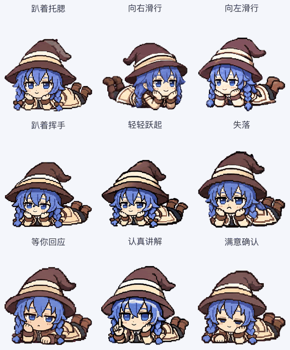
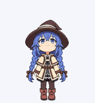

# Roxy Desktop Pet · 洛琪希老师

[中文](README.md)

An unofficial pixel-art Roxy Migurdia fan pet from *Mushoku Tensei*, with **9 animation states, 16 look directions, and 73 frames**. Her main pose is **lying on her belly with her chin on her hands**. Blue twin braids, a witch hat, and a cream mage outfit keep her recognizable at desktop size.

This visual redesign keeps her relaxed and belly-down throughout the animations instead of returning to an upright standing pose. The sprite-sheet format remains v2. The previous visual design is available in the [v1.0.0 Release](https://github.com/songxikang/roxy-desktop-pet/releases/tag/v1.0.0).



## Install

Use a ChatGPT / Codex desktop client that supports v2 custom pets. Availability, animation triggers, and synchronization depend on the client and version.

macOS / Linux:

```bash
git clone https://github.com/songxikang/roxy-desktop-pet.git
cd roxy-desktop-pet
bash scripts/install.sh
```

Windows PowerShell:

```powershell
git clone https://github.com/songxikang/roxy-desktop-pet.git
cd roxy-desktop-pet
powershell -ExecutionPolicy Bypass -File .\scripts\install.ps1
```

Refresh **Settings → Pets** and select **洛琪希老师**. Reopen the application if necessary. The installer copies only this pet's required files, backs up an existing installation with the same name, and does not change your active pet or install a background service. Use `--dry-run` or `-DryRun` to inspect the destination first.

For manual installation, preserve `pet.json` and `assets/spritesheet.webp` under `~/.codex/pets/roxy-desktop-pet/`, or under the `pets` directory in an existing user-configured `CODEX_HOME`. A client that accepts v2 sprite uploads can use [the transparent PNG](assets/spritesheet.png). Local pets and web pets do not necessarily synchronize. See the [official Pets documentation](https://learn.chatgpt.com/docs/pets).

## Included states

| State | Animation |
| --- | --- |
| Idle `idle` | Chin on hands, gentle breathing and blinking, with tiny boots swaying behind her |
| Move right `running-right` | Low belly-down glide toward the right, alternating short hands and boot kicks |
| Move left `running-left` | Low belly-down glide toward the left, alternating short hands and boot kicks |
| Wave `waving` | One hand supports her cheek while the other waves beside her face, then returns |
| Jump `jumping` | Her whole prone body gently lifts and settles back into the chin-on-hands pose |
| Disappointment `failed` | She lowers her head, closes her eyes, and slumps slightly before recovering |
| Wait `waiting` | She lifts her face expectantly and opens one palm to ask for a response |
| Work `running` | One hand supports her cheek while the other points toward her palm or forward as she explains |
| Review / ready `review` | She inspects, lifts her eyes, nods, smiles, and gives a small thumbs-up beside her face |
| 16 look directions | Head and gaze turn clockwise from up while her body and curled boots remain prone |

The host application decides when to play an animation. This repository does not add click, double-click, pointer-following, or task-notification behavior, and does not guarantee that every interface uses every state. Scheduled sleeping and automatic task-specific outfits are outside this package.



## Format and validation

- Transparent PNG and lossless WebP: `1536 × 2288`.
- Grid: 8 columns × 11 rows; each cell is `192 × 208`.
- Standard row counts: `6, 8, 8, 4, 5, 8, 6, 6, 6`.
- Two additional 8-frame look rows; 15 unused cells remain transparent.
- PNG and WebP decode to identical RGBA pixels.
- Creation QA covered structure, transparency, jump lift, directional meaning, and independent visual review. See [validation summary](docs/validation-summary.json).

Installing the pet requires no Python or API key. Optional file verification requires Python 3 and Pillow:

```bash
python3 -m pip install -r requirements.txt
python3 scripts/validate_assets.py
```

[Contact sheet](previews/contact-sheet.png) · [Look directions](previews/look-directions.png) · [Video](previews/all-states.mp4)

`prompts/` preserves the creative instructions and layout references. Reusing a prompt does not guarantee identical generated pixels.

## License

Original utility scripts and tests use the [MIT license](LICENSE-CODE). Character artwork and previews are excluded. This is an unofficial fan project; see [ASSET-NOTICE.md](ASSET-NOTICE.md).
