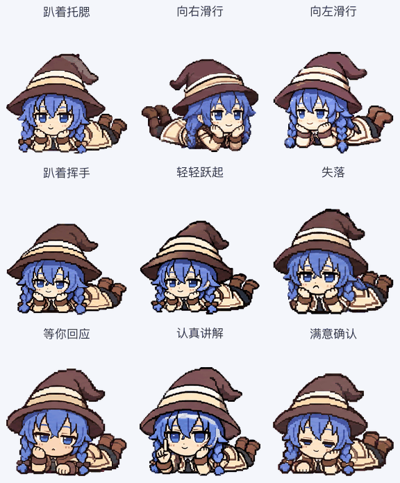

# 洛琪希老师 · Roxy Desktop Pet

[English](README.en.md)

《无职转生》洛琪希老师的非官方像素风桌宠。以 **趴着托腮** 为主姿态，保留蓝色双辫、魔女帽和米白法师服，配齐 **9 组动作、16 个注视方向，共 73 帧**。

新版围绕放松的腹卧姿态重新设计动作，不再一直站直；图集仍使用 v2 格式。旧视觉版保留在 [v1.0.0 Release](https://github.com/songxikang/roxy-desktop-pet/releases/tag/v1.0.0)。



## 安装

需要支持 v2 自定义宠物的 ChatGPT / Codex 桌面客户端。不同客户端和版本的宠物入口、互动触发和同步方式可能不同。

### macOS / Linux

下载本仓库，或运行：

```bash
git clone https://github.com/songxikang/roxy-desktop-pet.git
cd roxy-desktop-pet
bash scripts/install.sh
```

### Windows PowerShell

```powershell
git clone https://github.com/songxikang/roxy-desktop-pet.git
cd roxy-desktop-pet
powershell -ExecutionPolicy Bypass -File .\scripts\install.ps1
```

安装后在应用的 **Settings → Pets** 中刷新并选择「洛琪希老师」。若未出现，重新打开应用。安装脚本只复制此宠物的两个必需文件；同名安装会保留备份，不会切换当前宠物，也不会安装后台服务。

只想确认安装位置，可以先运行 `bash scripts/install.sh --dry-run`，或在 PowerShell 中使用 `-DryRun`。

### 手动安装 / 上传

- 本地安装：将 `pet.json` 和 `assets/spritesheet.webp` 按相同目录结构放入 `~/.codex/pets/roxy-desktop-pet/`。如果你已自行设置 `CODEX_HOME`，对应目录为其下的 `pets/roxy-desktop-pet/`。
- 支持 v2 上传的客户端：使用 [透明 PNG](assets/spritesheet.png)。若上传界面只接受旧版的 `1536 × 1872`，请勿裁掉最后两行后当作完整版本使用。
- 本地安装和网页宠物库不保证自动同步。客户端能力说明见 [OpenAI 官方 Pets 文档](https://learn.chatgpt.com/docs/pets)。

## 动作

| 动作 | 表现 |
| --- | --- |
| 待机 `idle` | 趴着托腮，呼吸、眨眼，轻晃身后的小靴子 |
| 向右移动 `running-right` | 腹卧低空滑行，头朝右，短手和小靴子交替摆动 |
| 向左移动 `running-left` | 腹卧低空滑行，头朝左，短手和小靴子交替摆动 |
| 挥手 `waving` | 一手撑脸，另一手抬到脸旁打招呼，再回位 |
| 跳跃 `jumping` | 整个趴姿轻轻浮起，再落回原来的托腮位置 |
| 失落 `failed` | 趴着低头、闭眼、塌肩，再慢慢恢复 |
| 等待 `waiting` | 抬脸期待地看向你，一手张掌请求回应 |
| 工作 `running` | 一手托腮，另一手举指、指向掌心或前方，认真讲解 |
| 检查完成 `review` | 低目检查后抬眼，点头、微笑，在脸旁竖拇指 |
| 16 个注视方向 | 身体和小靴子保持趴姿，头和目光从正上方开始顺时针转向 |

这些名称是客户端可调用的动画状态。实际触发方式由客户端控制；本仓库没有另行实现单击、双击、鼠标跟随或任务通知逻辑，也不承诺所有界面都会播放每种动画。


## 格式与检查

- 透明 PNG 与无损 WebP：`1536 × 2288`
- 网格：8 列 × 11 行；每格 `192 × 208`
- 前 9 行帧数：`6, 8, 8, 4, 5, 8, 6, 6, 6`
- 最后 2 行：16 个顺时针注视方向；剩余 15 格完全透明
- PNG 与 WebP 的 RGBA 像素一致
- 创作阶段已完成结构、透明背景、跳跃位移、方向语义与独立目视检查；见 [检查摘要](docs/validation-summary.json)

检查下载文件需要 Python 3 和 Pillow，安装桌宠本身不需要：

```bash
python3 -m pip install -r requirements.txt
python3 scripts/validate_assets.py
```

更多预览：[动作表](previews/contact-sheet.png) · [16 方向检查图](previews/look-directions.png) · [视频](previews/all-states.mp4)

## 项目内容

```text
assets/       最终图集和角色参考
previews/     GIF、视频、动作表
prompts/      主形象、动作与修订提示词及布局参考
docs/         格式、检查和角色注视方式
scripts/      安装与资源验证工具
pet.json      本地宠物描述文件
```

不包含 API 密钥，也不需要 API 密钥。生成提示词用于记录创作意图，不能保证重复生成相同像素。夜间睡眠、按任务换装等需要额外调度的功能未包含在本项目中。

## 许可

这是非官方同人项目。原创脚本和测试使用 [MIT 许可](LICENSE-CODE)；角色与视觉素材不在 MIT 授权范围内，详见 [素材说明](ASSET-NOTICE.md)。
